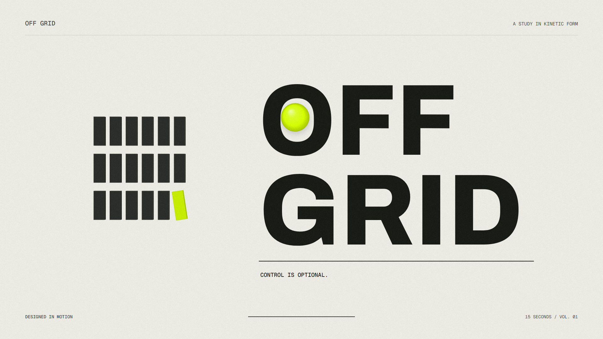

# OFF GRID / 脱离网格

15 秒原创图形动效。奶油白 #efeee6 / 墨黑 #171914 / 荧光黄 #d6ff00。



[观看或下载成片](OFF-GRID.mp4) · [下载整套工程 ZIP](https://github.com/a1332217069/off-grid-motion/releases/latest) · [关键帧总览](storyboard.jpg) · [完整抽帧](filmstrip.jpg)

成片：1920 × 1080、30 fps、450 帧、H.264 + AAC、48 kHz 立体声，时长 15.000 秒。使用 180° 快门子采样运动模糊。

画面概念：一颗球给规整模块施加冲动；同一组 18 个模块由网格、铰链波、空间虹膜、折叠塔，再回到有一块故意偏轴的网格。开场 IN LINE，收尾 OFF GRID。

| 时间 | 主动作 | 承接关系 |
|---|---|---|
| 0–1.30 | 有序网格、拉回预备 | 球与模块建立空间关系 |
| 1.30–2.40 | 球释放、逐列铰链波 | 球直接触发模块转动 |
| 2.40–4.18 | 网格卷为环形虹膜 | 保留全部 18 个模块 |
| 4.18–5.34 | 球膨胀成荧光黄舞台、镜头穿环 | 原有球形成转场 |
| 5.34–7.30 | 模块折为扭转叠塔、球环绕 | 模块数与身份不变 |
| 7.30–8.60 | 悬停、声画留白 | 保留雕塑和悬球 |
| 8.60–10.53 | 球下击、图形展开、OFF / GRID 字体节奏段 | 球贯穿四个有意硬切 |
| 10.53–13.00 | 模块收束、字标落位、尾部碰撞 | 模块回到网格，最后一块偏转 |
| 13.00–15.00 | 完整片尾停留 | 留出阅读与声音收束时间 |

## 使用

- `OFF-GRID.mp4`：成片。
- `comp.html?play`：实时交互预览，空格播放/暂停，左右键逐步移动，底部可拖动进度、打开声音。HTML 的时间轴和字体、配色、几何全部可编辑。
- `score.wav`：48 kHz 立体声原创合成声音。`score.py` 和 `events.json` 是声音源码与共享事件表。
- `storyboard.jpg`：关键帧总览。`QA.json`、`verification.txt`：实际验证记录。

## 本地播放

下载工程后，直接用浏览器打开 `preview.html` 播放成片。需要拖动时间轴观察源动画时，打开 `comp.html?play`，或从播放器底部进入实时预览。字体、声音和脚本均在项目内，无需生成服务。

也可在工程目录执行 `python -m http.server 8000`，打开 `http://localhost:8000/preview.html`。GitHub 仓库网页展示源码，不会直接执行 HTML 动画。

## 安装与重渲染

需要 Python 3.10 或更新版本，以及可从命令行调用的 FFmpeg / FFprobe。以下是 Windows PowerShell 示例：

```powershell
python -m venv .venv
.\.venv\Scripts\Activate.ps1
python -m pip install -r requirements.txt
python -m playwright install chromium --only-shell
.\render.ps1
```

渲染器和声音调色盘已放入 `tools/`，不依赖原机器上的 Codex 技能目录。环境安装需要网络；资源齐备后，播放和渲染使用本地素材。

macOS / Linux 可使用同样的 Python 依赖，并直接运行：

```sh
python score.py
python tools/render.py comp.html --out OFF-GRID.mp4 --sfx score.wav --workers 8 --gap 8 --samples-max 20
```

## 验证

```sh
python qa_comp.py
python qa_playback.py
python tools/verify_promo.py OFF-GRID.mp4 --comp comp.html --shots 0,1.3,1.6,2.4,4.18,5.34,7.3,8.6,9.12,9.48,9.8,10.13,10.53,13
ffmpeg -v error -i OFF-GRID.mp4 -f null -
```

原制作验证记录：`QA.json`（901 个时间采样、随机跳转确定性、离线资源与控件）、`playback-QA.json`（实际播放与跳转）、`verification.txt`（节奏、静止比例、声轨、连续性、边界检查全部通过）、`media-info.json`、`OFF-GRID.render.json`。`probe/` 保留运动曲线和轨迹数据。

发布整包包含成片、画面源码、音频源码与 WAV、字体、制作脚本、分镜、审查和验证记录。不包含 Python 虚拟环境、缓存，以及仅与本机 C/F 盘复制有关的记录。

## 素材与工具来源

画面与配乐为本项目程序化创作。无外部图片、音频采样和现成音乐。
Archivo / Geist Mono 字体使用 SIL OFL；许可保留于 `assets/FONT-LICENSES.txt`。
`motion.js`、on​etake 渲染器及声音调色盘采用 PolyForm Noncommercial 1.0.0；相关许可保留在 `ONETAKE-LICENSE`。本次作为非商业创作展示制作。
详见 [NOTICE.md](NOTICE.md)。
